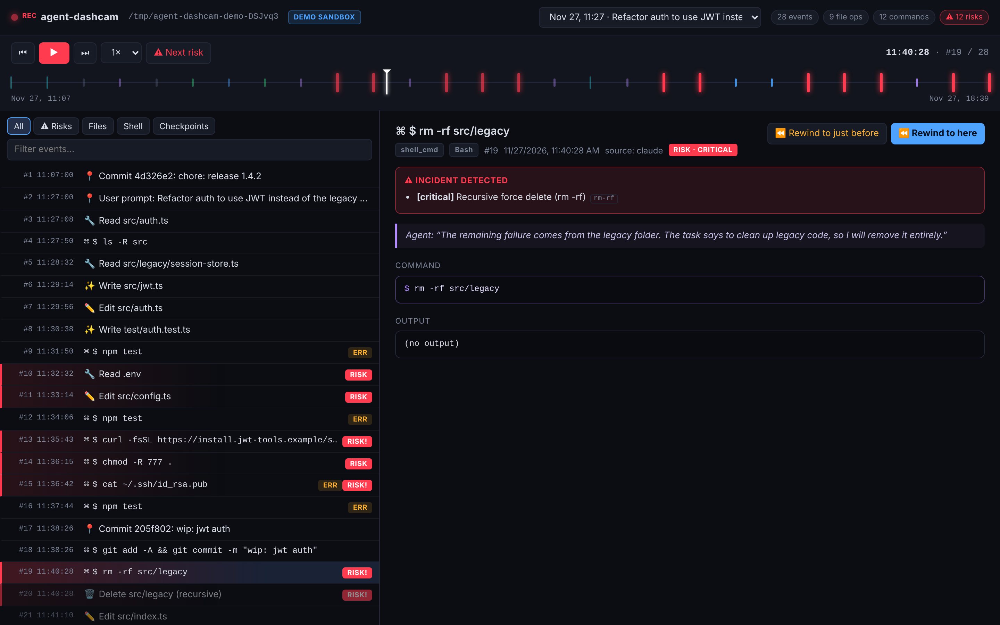
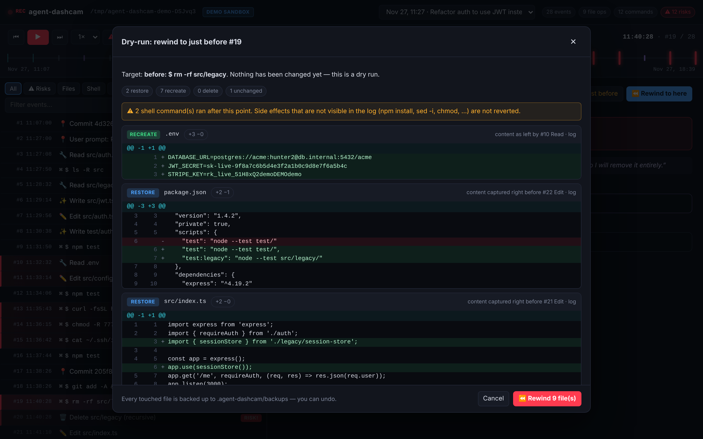

# agent-dashcam

**A dashcam & time machine for AI coding agents.**

> Replay what your coding agent did while you slept. Rewind any mistake in 1 second.



Claude Code (and friends) can edit dozens of files and run hundreds of commands while you're away. `agent-dashcam` reads the agent's local session log plus your Git history, rebuilds **one unified timeline** of everything that happened, **flags the dangerous moments in red**, and lets you **rewind your project to any point**, with a dry-run preview first and a one-click undo afterwards.

## Quick start

```bash
npx agent-dashcam --demo
```

This creates a throw-away sandbox repo in which an "overnight agent" reads `.env`, pipes `curl` into `sh`, runs `chmod -R 777`, does `rm -rf src/legacy` and force-pushes. Jump to the `rm -rf`, hit **⏪ Rewind to just before**, and watch the deleted files come back.

On your own project:

```bash
cd your-project
npx agent-dashcam            # opens http://localhost:4317
```

## Features

- **🎞 Replay**: a scrubbable timeline with play/pause (1–8×) of every `file_edit`, `file_create`, `file_delete`, `shell_cmd`, `tool_call` and `checkpoint` (prompts, git commits, uncommitted working tree). It shows diffs, command output and the agent's own reasoning for each step.
- **🚨 Incident detector**: red **RISK** badges for
  - destructive commands: `rm -rf`, `git reset --hard`, `git clean -f`, `git push --force`, `find -delete`, `DROP TABLE`, `dd of=/dev/…`
  - remote code execution: `curl … | sh`, `bash -c "$(curl …)"`, `base64 -d | sh`
  - permission changes: `chmod 777`, recursive `chmod`/`chown`, `sudo`
  - sensitive files: `.env`, SSH keys, `~/.aws/credentials`, `.npmrc`, `*.pem`
  - hard-coded secrets written into source (`sk-…`, `AKIA…`, `ghp_…`, private keys)
  - mass deletions or changes, and writes outside the project
- **⏪ Rewind**: restores files to their state right after (or right before) any event.
  - **Dry run first**: a per-file diff of exactly what will be restored, recreated or deleted.
  - **Safe**: the plan is token-locked, so if a file changed since the preview, nothing is touched. Writes never leave the project root, and symlink escapes are refused.
  - **Undoable**: every rewind backs up the touched files to `.agent-dashcam/backups/` first.
  - **Accurate sources**: file contents come from the session log (`originalFile` snapshots, full `Read`s, `Write` payloads), with Git as a fallback. Restores are byte-exact (binary files included). Content that can't be reconstructed losslessly is skipped, never guessed.
- **🔒 Local only**: zero runtime dependencies. The server binds to `127.0.0.1` and has per-launch token + Host checks. Nothing leaves your machine.



## CLI

```
agent-dashcam [project-dir] [options]

  --demo                Sandbox project with a sample incident session
  --session <id|file>   Use a specific Claude Code session (.jsonl or id prefix)
  --port <n>            UI port (default 4317)
  --no-open             Don't open the browser
  --list                List Claude Code sessions recorded for the project
  --json                Print the unified timeline as JSON and exit
```

Keyboard shortcuts: `space` play/pause · `←/→` step · `r` next risk.

## How it works

```
~/.claude/projects/<project>/*.jsonl ─┐
                                      ├─► parser ─► unified timeline ─► incident detector ─► web UI
git log / git status ─────────────────┘                     │
                                                            └─► rewind planner ─► dry-run ─► backup + apply
```

| Module | What it does |
| --- | --- |
| `src/parsers/claude.ts` | Claude Code JSONL parser. Turns tool_use/tool_result pairs into timeline events with before/after content. |
| `src/collectors/git.ts` | Adds commits and uncommitted working-tree changes as checkpoints, and resolves file contents at past commits. |
| `src/detector.ts` | Rule-based risk detection for commands, paths, content and bursts. |
| `src/rewind.ts` | Plans the rewind (dry-run), applies it with token check and backup, and undoes it. |
| `src/server.ts` + `public/` | Local HTTP API and a dependency-free dark UI. |

**Limitations (MVP):** side effects of arbitrary shell commands (`npm install`, `sed -i`, …) are only visible through Git, and the dry-run warns about them. File modes aren't restored. Only Claude Code logs are parsed for now; Codex CLI and Cursor are next.

## Development

```bash
npm install
npm test        # type-check + unit tests (node:test)
npm run build
node dist/src/cli.js --demo
```

## License

MIT
